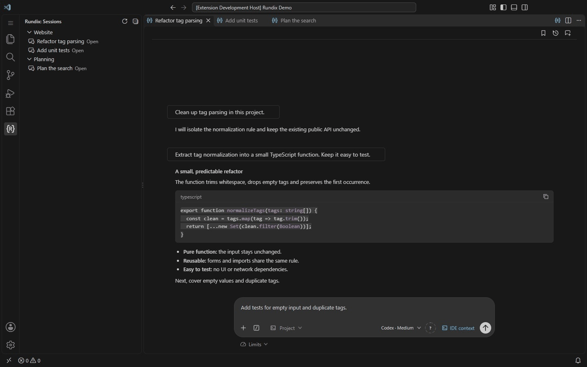
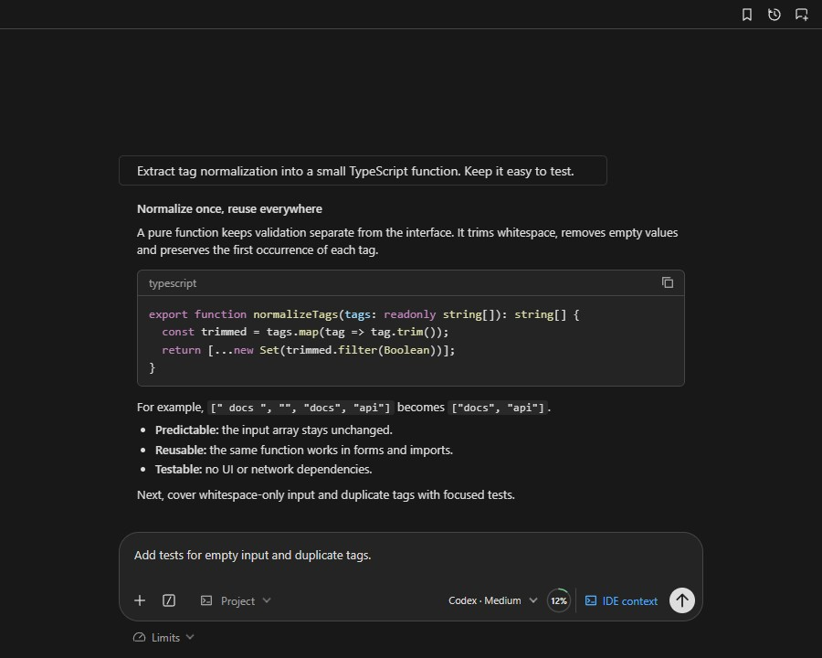
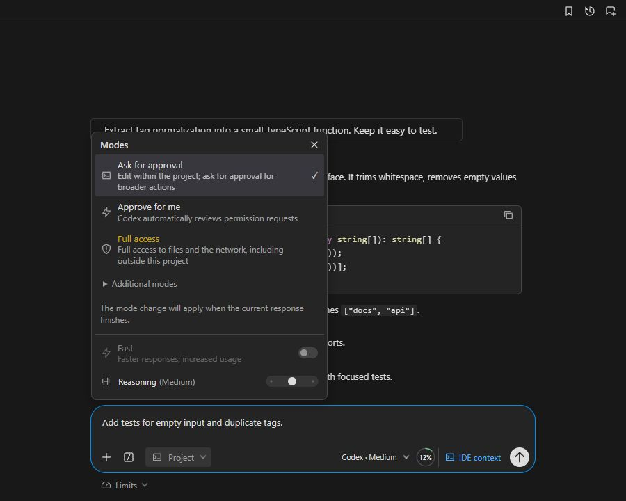
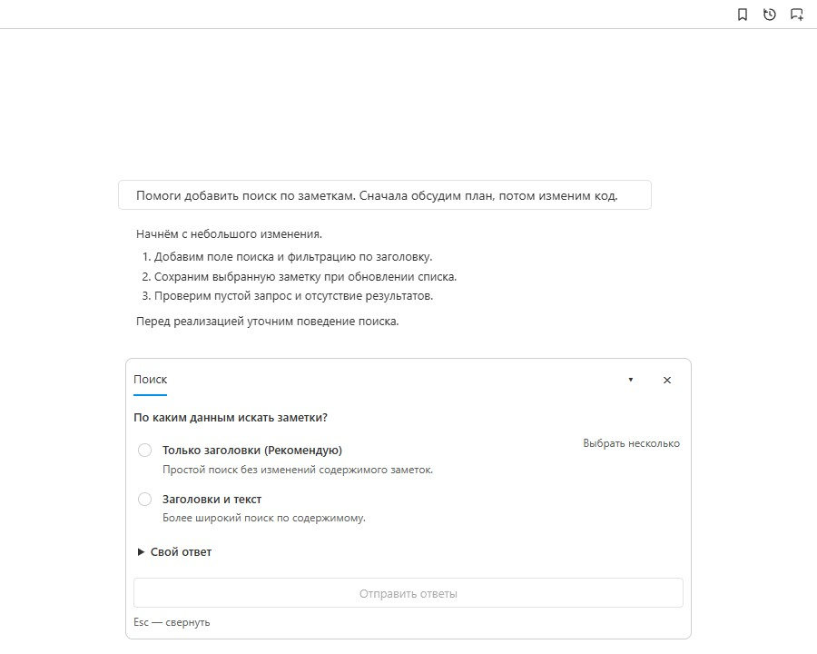

<div align="center">
  
  <h1>Rundix — Codex CLI for VS Code</h1>
  <p>Source version: <a href="standalone/package.json"><strong>0.2.2</strong></a> · <a href="standalone/CHANGELOG.md">Version history</a></p>
  <p><strong>Your coding agent, in your editor.</strong><br>Native chat tabs · Images and project context · Follow-up queue · English / Русский</p>
  <a href="https://marketplace.visualstudio.com/items?itemName=local-rundix-tools.rundix"></a>
  <p><a href="#screenshots">Demo &amp; screenshots</a> · <a href="standalone/CHANGELOG.md">What's new</a> · <a href="#русский">Русский</a> · <a href="https://github.com/uladzemer/Rundix/issues">Feedback</a></p>
</div>

**An AI coding assistant powered by the official Codex CLI, inside Visual Studio Code.**

Keep conversations in native editor tabs, add images and project files, and queue follow-ups while your coding agent works. Choose models, reasoning effort and access modes from the chat.

Rundix uses your existing Codex CLI sign-in by default. The CLI manages credentials; Rundix does not read or copy authentication files. Compatible companion extensions can provide an explicitly selected alternative through the [connection API](standalone/docs/connection-api.md).

Rundix is an independent project and is not an official OpenAI product.

## Why Rundix?

| What you need | What Rundix offers |
| --- | --- |
| Keep several tasks organized | Native VS Code chat tabs, session history, groups, bookmarks and conversation branches |
| Give the agent useful context | Image paste, file attachments, selected code and optional IDE context |
| Add the next step without losing it | Editable follow-up queue, task reordering, steering and sending a queued task to a new tab |
| Read and review results | Streaming Markdown, highlighted code and file changes |
| Control how a task runs | Model and reasoning selection, access modes and supported Fast tiers |
| Work in your preferred interface | English and Russian, VS Code theme colors, chat width and motion settings |

Available models, Fast tiers and usage limits depend on your account and CLI version.

## Install

Install [Rundix from the Visual Studio Marketplace](https://marketplace.visualstudio.com/items?itemName=local-rundix-tools.rundix), then run **Rundix: New tab** in VS Code. Future updates are delivered through the Marketplace.

Already signed in to Codex CLI? Start chatting. Otherwise, open `/account` → **Sign in through browser**, or run `codex login` in your terminal.

## Screenshots

### A quick tour



Real Rundix UI with synthetic demo content; no model request or personal conversation. The tour cycles through three scenes. Native VS Code tabs are outside the captures.

<details>
<summary>View still screenshots</summary>

Chat, highlighted code and the message composer:



Access modes and reasoning effort:



Questions in Russian, in the light theme:



</details>

## What's new

The latest interface and installation guidance are documented in the [changelog](standalone/CHANGELOG.md). Install and update Rundix through **Microsoft Marketplace**; GitHub hosts the source and documentation.

## Support the project

If Rundix is useful to you, **[give it a star on GitHub](https://github.com/uladzemer/Rundix)** using the **Star** button at the top of this page. It helps other developers discover the project and lets you find it again later.

Found a bug or have a feature idea? [Open an issue](https://github.com/uladzemer/Rundix/issues) with the expected behavior and steps to reproduce. Please leave out credentials, private conversations and personal paths.

<details>
<summary>Development and local checks</summary>

The extension source is in [`standalone/`](standalone/README.md).

```powershell
npm.cmd run setup
npm.cmd test
npm.cmd run test:browser
npm.cmd run package
```

The package is written to `standalone/rundix-<version>.vsix`. Browser checks need Chrome; set `CHROME_PATH` if it is not installed in a standard location. Extension Host checks run in an isolated VS Code profile. Synthetic checks do not send model requests.

The extension ID is `local-rundix-tools.rundix`. Its commands, settings and storage are separate from other editions.

</details>

## Русский

Rundix — AI-помощник для программирования на базе официального Codex CLI в Visual Studio Code. Чаты открываются во вкладках редактора; доступны Markdown и подсветка кода, изображения, файлы и контекст проекта, очередь уточнений, история, группы, закладки и ветки разговоров.

Установите [Rundix из Visual Studio Marketplace](https://marketplace.visualstudio.com/items?itemName=local-rundix-tools.rundix), затем выполните **Rundix: Новая вкладка** в VS Code.

Выбирайте модель, глубину рассуждения и режим доступа прямо в чате. Доступность моделей, Fast и лимитов зависит от аккаунта и версии CLI. Интерфейс поддерживает русский и английский языки и цвета вашей темы VS Code.

По умолчанию используется текущая авторизация Codex CLI на компьютере. Учётными данными и их хранением управляет CLI. Расширение не читает и не копирует файлы авторизации. Если вход отсутствует, меню аккаунта позволяет открыть официальный вход через браузер. С версии 0.2.0 дополнительный установленный модуль может предоставить другой способ подключения через версионируемый API; он включается явно, а его авторизацией управляет модуль.

Подробности: [`standalone/README.md`](standalone/README.md). Лицензия кода и собственных значков — [MIT](LICENSE); лицензии включённых библиотек собраны в `standalone/THIRD_PARTY_NOTICES.txt`.

Если Rundix вам полезен, поставьте **Star** вверху страницы репозитория. Об ошибках и идеях можно рассказать в [Issues](https://github.com/uladzemer/Rundix/issues), без ключей и личных переписок.

Изменения версий — в [истории изменений](standalone/CHANGELOG.md). Установка и обновления доступны через **Microsoft Marketplace**; в GitHub хранятся исходники и документация.
