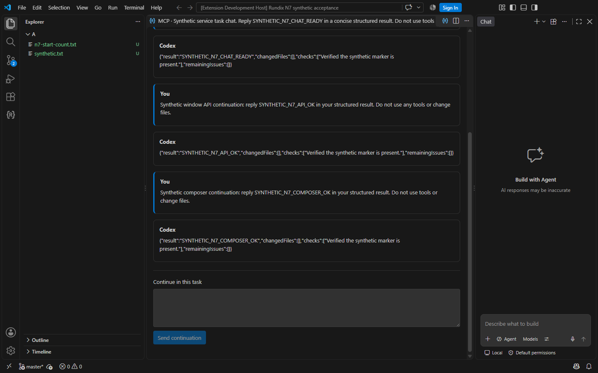

# Live acceptance: headless service, 21 October 2026

Owner-authorized Windows run against `e47ca1b` (Rundix 0.3.1).
Node 24.19.0 from PATH, Rundix-managed Codex 0.163.0, Claude Code 2.1.296.
The installed private provider was used unchanged. No provider implementation
or credentials were copied into this repository.

## Results

| Step | Result | Observed evidence | Duration |
| --- | --- | --- | --- |
| N3: no window executor | PASS | A separate `claude -p` in synthetic Git repo A called `submit_task`, `wait_task`, `get_task`, `close_task`. Task completed and a full structured report returned through the real provider/CLI. One service-main process was observed; Codex argv contained the ephemeral credential-store flag. | 32 s |
| N4: two launch spaces | PASS | Overlapping Claude processes in independent repos A/B each submitted and completed one task. Subsequent parallel Claude checks listed only their own space's tasks; foreign `get_task` returned `unknown_task` in both directions, while own reads completed. One service-main process was observed. | A: 24 s; B: 36 s; cross-checks: 7/6 s |
| N5: isolated VS Code | PASS | Freshly packaged VSIX installed in temporary extensions/profile directories. The installed extension's real API started its service client: panel snapshot connected, included A's task, excluded B's task, and had no window MCP executor. | 1 s for host assertions |
| N6: crash/restart | PASS | Only the verified Node service-main process with the installed runtime/root in its command line was force-stopped. The next Claude request started a different service PID on demand, listed earlier tasks, completed a new task and returned its report. An explicit identical requestId retry returned the same completed task. | 32 s |

The final CLI check followed process ancestry from the verified service owner:
one owned Codex process, with the ephemeral flag present. It did not rely only
on finding a matching flag in an unrelated window's CLI.

The initial service root was absent. Installation used
`service-launcher.installLauncherAsync` from this worktree, with PATH Node;
settings used `writeServiceSettings` with global values `mcpAccessMode: full`,
`mcpMaxParallelTasks: 3`, and the managed Codex executable. Claude used only a
temporary `--mcp-config`, `--strict-mcp-config`, explicit MCP allowedTools and
`--no-session-persistence`. Its output was filtered in memory to tool names,
task IDs/states and booleans; report/chat text and stderr text were not logged.

The N5 host initially ran before its isolated extension installation had
completed and failed the extension-presence assertion. After installing through
`code.cmd`, the same isolated host checks passed. This was a harness setup
correction, not a product defect. The window client was disconnected, its test
window exited, and the service registration was restored through the product
installer to PATH Node.

Before/after N6, all three earlier tasks retained identical task/chat IDs,
states, revisions and report hashes. There were exactly four completed tasks
across A/B after the new submission and its retry: no duplicate task or observed
re-execution. All four were closed through the service API.

## N3–N6 safety and limits

- Personal Codex `auth.json` existed; only stat metadata was obtained. Its size
  and mtime were identical before installation and after all live task runs.
  No authentication-file contents, tokens, account emails or personal session
  chat text were inspected or printed.
- The owner's VS Code window and its MCP bridge remained running. No reload,
  bridge stop, Code.exe kill, owner-profile installation, owner settings edit
  or Claude configuration edit was performed. N3 means execution independent
  of a window executor; closing all VS Code windows was deliberately excluded.
- Repositories, MCP configuration, filtered evidence and N5 profile/extensions
  were created under a newly allocated temporary directory. Only synthetic
  repository data was used for task requests and report verification.
- The production root `%LOCALAPPDATA%/Rundix/service` is retained. Provider
  configuration/payload and the owner's installed editions remain unchanged.
- N3–N6 required no runtime fix or new regression test. This is live
  model-request evidence on one Windows machine. At that stage active-turn
  crashes and task-chat continuation were untested; N7 below extends coverage.
  Quota exhaustion/rotation and macOS remain outside this run.

## Local validation and shutdown

`npm.cmd run package` passed, including the actual ZIP audit (137 entries).
The packaged identity/version, README, three branding assets, extension host
and key service sources were also checked against the worktree bytes.

All clients were disconnected and the service exited through its unchanged
five-minute idle policy. Diagnostics recorded two starts (initial and N6
recovery) and one graceful stop; the intentionally killed instance could not
record a stop. The discovery file disappeared, no service-main process remained,
and the isolated VS Code profile had no remaining processes. The production
root retained the PATH Node registration and the requested service settings.
Personal auth size/mtime still matched after service shutdown.

One generic `host_error` appeared immediately before `service_stopped`.
A separate synthetic provider/CLI reproduction of ordinary `host.dispose()`
produced the same two codes. Source review shows CLI stop emits a disconnect
message through core output, and the safe logger maps strings to `host_error`.
This is diagnostic noise, not evidence of an inference or shutdown failure;
no `idle_exit_failed` or `provider_unavailable` was observed in the live log.
No raw error text was captured to investigate it.

`npm.cmd test` passed all 54 suites, with 62 real-root guard PASS messages
(metadata only). `git diff --check` passed. No browser/layout checks were run
because no product UI or runtime source changed; N5 used the installed VSIX
in a real isolated Extension Host. The acceptance record was checked against
the filtered evidence and relevant source using `REVIEW.md`; this is author
verification, not an independent review. No push or publication was performed.

## N7 follow-up

Owner also reported an independent successful `claude -p` verification. N7
used a newly allocated temporary directory and fresh synthetic Git repo A.
A pre-existing service instance was allowed to exit normally before installing
and starting the N7 runtime. Fix commit: `d70b13d`.

| Check | Result | Evidence |
| --- | --- | --- |
| Expected shutdown diagnostics | PASS (synthetic and live) | Only the exact fixed CLI stop message while provider disposal is active maps to `cli_stopped`. The same message outside disposal and an actual protocol error during disposal still produce `host_error`. The lifecycle flag resets in `finally`; no message payload is logged. Live idle exit recorded `cli_stopped` then `service_stopped`, with no `host_error`. |
| Crash during active turn | PASS | A real Codex turn began a synthetic 60-second progress loop and wrote its start marker. While task state was `running`, only the verified service-main PID was force-stopped. The next space-bound `get_task` demand-started the service and returned `running` (revision 6); `wait_task` then reconciled to `cancelled` (revision 7), `recoveryRequired:false`, no report, progress `Turn finished`. Total crash scenario: 14 s. No submit/continue replay was performed for that task; its command-start count was one. |
| Service task chat in isolated VS Code | PASS | Fresh VSIX in temporary profile/extensions, service mode, folder A. The installed extension opened the service-owned transcript. `api.mcp.chatAction(...continue...)` completed in the same chat and appeared in the rendered transcript; no local window session owned that chat. A second continuation used a programmatic form submit without keystrokes, exercising the webview-to-window API and its reply handling. Its rendered response appeared and the actual composer textarea was empty. Host assertions: 12 s; renderer checks/capture: 14 s. |

The window screenshot was captured from the isolated instance's renderer through
its temporary localhost debugger, never from the desktop or another Code window.
It was visually inspected: only synthetic repository/task text is visible.

Harness corrections: an initial call omitted required `projectDirectory` and
was rejected before creating a task. The first valid submission then failed
closed with the fixed `action_required` reconnect message before model dispatch,
preserving one unsent input. Public API probes confirmed installation validation,
authentication and probe/admit readiness; an explicit fresh submission completed
the intended crash scenario. The refused task never wrote a command-start marker.
No cause in the public runtime was established for that transient refusal, and
the private provider/configuration was not changed.

Validation: focused shutdown regression passed; `npm.cmd test` passed all 54
suites in 112 s with 62 real-root guard PASS messages. Package build and actual
137-entry ZIP audit passed; identity, README, branding and key service source
bytes were checked. A separate read-only reviewer reported zero confirmed
findings in the two-file fix (static review; no owner access or live execution).

All three N7 tasks (refused, crash-cancelled and chat-completed) were closed.
The isolated host exited normally. The product installer restored PATH Node
registration; settings remain `full`, parallelism 3, managed Codex 0.163.0.
Process ancestry confirmed one service-owned CLI with the ephemeral flag.
Personal auth size/mtime matched after all live requests and again after the
unchanged idle policy stopped the service. The N7 diagnostic sequence was
`service_started`, `service_started`, `cli_stopped`, `service_stopped`: two
instances including crash recovery, no generic shutdown error. Discovery was
removed, the production root retained, and no service-main or isolated-profile
Code processes remained. The command-start marker still counted exactly one
after shutdown, several minutes after the crash; no silent re-execution was
observed. `git diff --check` passed. Fix, acceptance log and screenshot were
committed locally with the requested co-author trailer; no push/publication.
